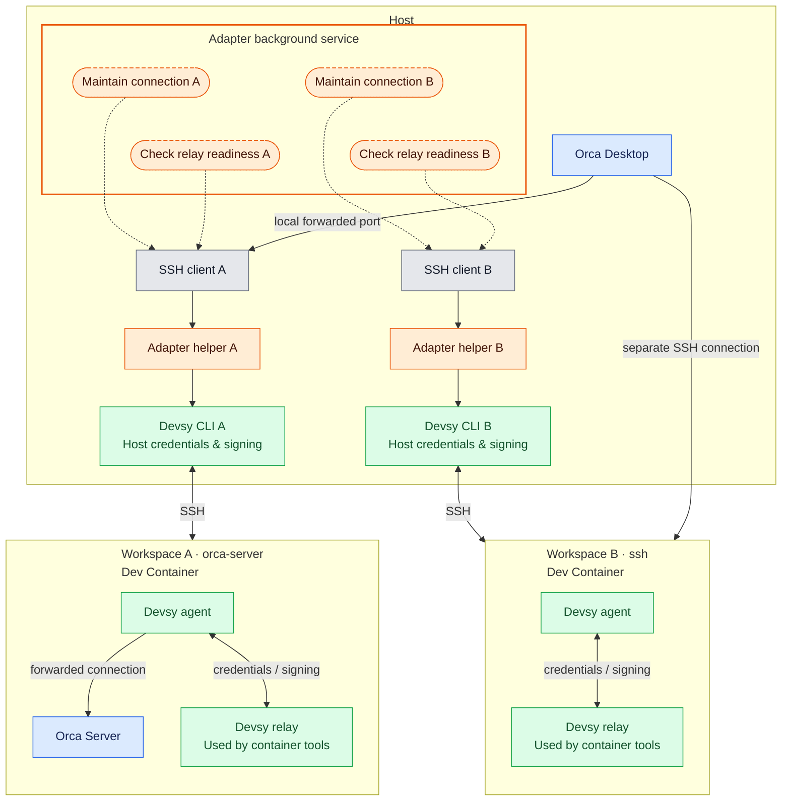

# orca-env-devsy

Run Orca tasks in development containers, using Devsy to manage those containers
across local and remote providers. Choose an environment in Orca, and keep using
Orca for your files, terminals and agents while they run in that environment.

Orca calls this experimental feature **Cloud VM**: a repository defines an
environment recipe, and each new workspace can start its own environment from
that recipe. Despite the name, it also works with local Docker. This adapter
connects those recipes to [Devsy](https://devsy.sh), so Docker, Apple Container,
cloud machines and other Devsy providers share the same Orca lifecycle. Each
provider still needs its own setup, credentials and available resources.

Run agents in YOLO mode in a separate, disposable development environment to
limit the impact of agent mistakes on your host. Choose a local container or a
remote machine while keeping the same Orca workflow.

## How the adapter fits

- **Orca** presents the environment choices and owns task worktrees and agents.
- **Devsy** builds and runs the development container on the selected provider,
  using the repository's Dev Container configuration.
- **orca-env-devsy** translates Orca's create, suspend, resume and destroy calls
  into Devsy operations. It prepares the checkout, returns the connection details
  Orca needs, and maintains the connection. For Orca Server connections, it also
  installs and starts Orca inside the container.

You configure a recipe once; ordinary task creation then happens in Orca.

## Quick start: Docker

This walkthrough starts with a repository that has no Dev Container configuration.
It creates one Docker recipe with an Orca Server connection. You need:

- Orca desktop, [mise](https://mise.jdx.dev), and a running Docker daemon accessible
  through `docker`.
- Git, OpenSSH, a POSIX shell and `env` supporting `-u` on the host.
- A repository already added to Orca, with a Git remote the container can clone.
  For private repositories, prepare your host's Git credentials or SSH agent.

Adapter binaries support macOS 13+ on Apple Silicon, and Linux x86_64/arm64 with
glibc 2.31+. The container runs Linux x86_64 or arm64.

### 1. Add the tools

Run this from your repository's primary checkout:

```sh
mise use 'github:devsy-org/devsy[matching=devsy-]' github:atty303/orca-env-devsy
```

This adds both tools to the repository's mise configuration and installs them.

Register Docker in Devsy once for your current Devsy context; skip this command
if that context already has a Docker provider:

```sh
devsy provider add docker
```

### 2. Define the container

Create `.devcontainer/devcontainer.json`:

```json
{
  "image": "mcr.microsoft.com/playwright:v1.64.1-noble",
  "remoteUser": "pwuser"
}
```

The Microsoft Playwright image includes the browser runtime libraries required
by Orca, plus Git, curl and SSH tools. The adapter downloads Orca itself on first
creation.
If you already have a Dev Container, adapt it instead of replacing it, and ensure
it supplies these libraries and tools. Project-specific build tools can be added
after the first successful connection.

### 3. Add an Orca recipe

Add the following to the repository's `orca.yaml`, preserving any existing
settings and recipes:

```yaml
devsy:
  connection: orca-server
  buildRef: main
  upArgs: ["--provider", "docker"]

environmentRecipes:
  - id: devsy-docker
    name: Docker
    checkoutMode: orca-worktree
    create: mise exec -- orca-env-devsy recipe create
    suspend: mise exec -- orca-env-devsy recipe suspend
    resume: mise exec -- orca-env-devsy recipe resume
    destroy: mise exec -- orca-env-devsy recipe destroy
```

The remote build branch supplies the
container build, including its Dev Container files and lifecycle commands;
Orca separately creates the task's worktree inside the environment.

### 4. Publish the configuration and start a task

Commit the mise configuration, its lockfile if generated, `.devcontainer` files
and `orca.yaml`, then push the build branch to your remote. The container builds
from the remote, so uncommitted or unpushed files are not enough. Also ensure the
recipe is present in the project's primary checkout: Orca discovers the choices
for new workspaces there.

In Orca, enable **Settings → Experimental → Cloud VM**. Create a new workspace
and choose **Docker** under **Run on**. The first creation pulls the image,
clones the repository and installs Orca Server, so it takes longer than later
starts.

Once connected, open a terminal in that workspace, list the repository files,
then create and read a small file. Confirm that it appears in Orca's file view.
You now have the environment needed to start a task; configure your chosen agent's
authentication in that environment when required.

## Features

The examples in this section are configuration fragments or individual commands.
They extend the Docker walkthrough or your own recipes.

### Providers and reusable profiles

Use any prepared Devsy provider by passing its name in `upArgs`. Provider options
and native Devsy arguments stay available; a recipe does not need a separate
implementation for each backend. For example, after registering an `apple`
provider, select it with a profile:

```yaml
devsy:
  profile: local
  profiles:
    local:
      upArgs: ["--provider", "docker"]
    apple:
      upArgs: ["--provider", "apple", "--platform", "linux/arm64"]
```

Set `devsy.profile: apple` on a recipe to select that profile. Settings apply in
common → selected profile → recipe order. `upArgs` append, so put the provider
argument in the profiles instead of also retaining the common Docker `upArgs`.
The adapter reserves arguments such as workspace identity and result format;
provider registration, accounts and secrets remain Devsy/user responsibilities.

### Connections and checkouts

Task files, terminals and agents run inside the Devsy container in all three
combinations below. These fragments belong to an `environmentRecipes` entry.

`orca-worktree` recipes must set `buildRef` because Orca does not pass a default
ref in this mode. It selects the remote checkout supplying the Dev Container
configuration and lifecycle commands.

**Orca Server + Orca-managed worktree** (the Quick start configuration): the
container runs its own Orca runtime, and your desktop connects as a client through
an adapter-managed local tunnel. Orca creates a linked worktree for the task.
Use this connection for Orca's native chat in the environment; SSH recipes do not
support native chat.

```yaml
checkoutMode: orca-worktree
devsy:
  connection: orca-server
  buildRef: main
```

The adapter installs the latest stable official Linux Orca when absent and starts
its Server. Resume reuses that installation; it does not update Orca.

**SSH + Orca-managed worktree**: your desktop Orca manages the workspace over SSH
and creates a linked task worktree in the container. The adapter provides the SSH
connection rather than starting Orca Server.

```yaml
checkoutMode: orca-worktree
devsy:
  connection: ssh
  buildRef: main
```

**SSH + provisioned checkout**: your desktop Orca connects over SSH and uses the
checkout prepared by the adapter directly. The adapter checks out Orca's supplied
task branch and commit; Orca does not create an additional linked worktree.

```yaml
checkoutMode: provisioned-root
devsy:
  connection: ssh
```

With `provisioned-root`, `buildRef` can be omitted: the build uses Orca's supplied
start ref and commit.

Both SSH combinations use Devsy's generated SSH configuration, including its
host-key and agent-forwarding settings.

### Devsy contexts, commands and environment variables

Select an existing Devsy context or a separate state directory, or run Devsy
through a launcher:

```yaml
devsy:
  context: "${DEVSY_CONTEXT?}"
  home: /absolute/path/to/devsy-state
  command: ["/absolute/path/to/devsy-launcher", "--environment", "development"]
```

All are optional; the default command is `devsy`. `${VAR}` expands to empty when
undefined; `${VAR?}` requires it to be defined, but permits an empty value.
Arguments are passed without shell evaluation or word splitting. `command`
replaces the whole command array and must work from later Orca invocations too.
Keep credentials in Devsy's credential configuration, not command arguments.

Effective settings are saved when an environment is created. Editing YAML changes
new environments; existing ones keep their saved lifecycle settings.

### Suspend, resume and destroy

Orca invokes the recipe's lifecycle commands when you suspend, resume or delete
the environment. Suspending stops the Devsy workspace; resuming starts it and
restores the connection. Destroying deletes the workspace and cleans up the
adapter's owned connection state.

Server environments keep task worktrees and the Orca profile in a dedicated
volume at `/workspaces/.orca`. Keep that volume mounted when recreating a
container to preserve them. Destroy attempts volume cleanup; unsupported provider
layouts or cleanup failures produce warnings.

For example, the resume entry in each recipe is:

```yaml
resume: mise exec -- orca-env-devsy recipe resume
```

These `recipe` commands consume Orca's lifecycle input; use Orca for ordinary
single-workspace actions rather than running them without that input.

### Connection recovery

Connections retry transient transport failures automatically. To restore saved
connections manually, for example after a host restart:

```sh
orca-env-devsy recover
```

To replace the adapter's connections and reconnect:

```sh
orca-env-devsy restart
```

Recovery attempts the saved enabled connections, retaining their target identity
and forwarding ports. One failed target does not prevent attempts on the others.
It does not provision a replacement workspace; Devsy's SSH connection may start
an existing stopped workspace.

### Status and bulk operations

Inspect adapter-managed environments in the effective Devsy context for a provider:

```sh
orca-env-devsy status --provider docker
```

The JSON result includes workspace state and Orca activity. Stop idle environments
or resume stopped ones with:

```sh
orca-env-devsy stop --provider docker
```

```sh
orca-env-devsy resume --provider docker
```

`stop` skips environments whose activity is active or unknown. Add `--force` to
stop without the activity check. These commands target saved adapter-managed
environments, not every workspace in Devsy.

### Automatic idle stop

Opt a recipe into automatic stopping after an idle period:

```yaml
devsy:
  idleTimeout: 30m
```

Durations use `s`, `m`, `h` or `d`. Activity is based on Orca's agents and terminals,
not simply whether the desktop is connected. The adapter requires a fresh idle
confirmation before stopping; it does not stop solely because observation fails.
Use `status` to inspect the timer, and resume through Orca or the bulk command.

### Devsy relay monitoring

The adapter monitors the readiness of Devsy's credential and signing relay,
which supports services such as Git and Docker registry authentication. Devsy
owns relay recovery. Readiness is separate from the Orca connection and does not
verify that a remote service will accept the credentials.

### Codex authentication handoff

The adapter's optional Codex addon hands off file-backed host ChatGPT
authentication at create/resume:

```yaml
devsy:
  addons:
    codexAuth: true
```

This requires the host `codex` CLI and managed ChatGPT file authentication. The
addon refreshes when needed and forwards access/account data without refresh
credentials. It preserves manually changed remote authentication, does not support
API keys or keyring-only authentication, and does not synchronize continuously.
Authentication delivery problems warn without failing environment creation.

### Diagnostics

Lifecycle progress appears on stderr with UTC timestamps and stage durations.
Bounded local diagnostic records are stored in
`${XDG_STATE_HOME:-$HOME/.local/state}/orca-env-devsy/events.jsonl`. Use the run ID
and failed stage to locate the underlying subprocess failure. Records exclude
credentials and pairing data; there is no remote telemetry.

To disable recording for an operation:

```sh
env ORCA_ENV_DEVSY_RECORDING=0 orca-env-devsy status --provider docker
```

## Further reference

- `orca-env-devsy --help` lists adapter commands.
- [Devsy documentation](https://devsy.sh/docs) covers provider setup, contexts,
  Dev Container configuration and native CLI options; use
  `devsy --help` for CLI reference.
- [Orca's environment guide](https://www.onorca.dev/docs/ways-to-run#4-cloud-vms-per-workspace-environments)
  explains Cloud VM recipes and the desktop workflow.
- [Configuration and contracts](docs/contracts.md) describes the complete settings
  and lifecycle contracts, connection requirements and diagnostic controls.

## Process model

The adapter runs one background service (the supervisor) for all workspaces.
For each workspace, it maintains the SSH connection and checks Devsy's relay
through that connection.

Each monitored connection uses three processes: an **SSH client** that maintains
the connection, an **adapter connection helper** that manages Devsy's process
lifetime, and the **Devsy CLI** that connects to the container. The container's
Devsy relay forwards credential and signing requests to the host-side Devsy CLI.
For `orca-server`, Orca Desktop reaches Orca Server through the forwarded port.
For `ssh`, Orca Desktop opens a separate SSH connection; the monitored connection
keeps Devsy's relay available.

Rectangles are processes; rounded dashed boxes show responsibilities within the
adapter background service. Orange is the adapter, green Devsy, blue Orca, and
gray the SSH client. Dashed arrows show operations through the SSH client; solid
arrows show connections and credential/signing requests. The separate SSH
connection from Orca Desktop is abbreviated; it also uses an adapter helper and
Devsy CLI.


